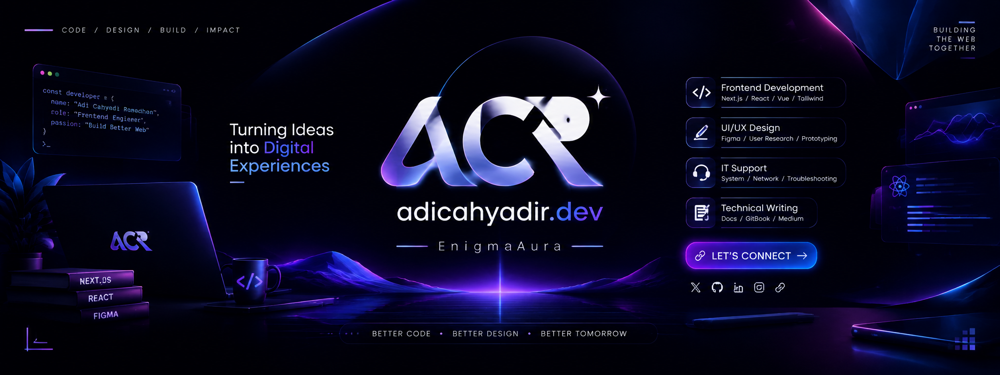

<div align="center">



<br/>


<br/>

<h1>
  Adi Cahyadi Ramadhan
</h1>

<p>
  <b>Frontend Engineer • UI/UX Designer • Creative Developer</b>
</p>


<p>
  <a href="README-ID.md">
    🇮🇩 Indonesia
  </a>
  •
  <a href="README.md">
    🇬🇧 English
  </a>
</p>


</div>


---

## 👋 About Me

I'm **Adi Cahyadi Ramadhan**, known online as **EnigmaAura**.

A developer who enjoys transforming ideas into modern digital experiences through:

- ⚡ Frontend Engineering
- 🎨 UI/UX Design
- 🤖 AI-powered Applications
- 🛠️ System & Technical Solutions


I focus on creating interfaces that are:

> **Fast • Beautiful • Functional • User-Centered**


Currently building with **React, Next.js, TypeScript, and modern frontend architecture** while exploring AI integration and the future of the web.


---

## 🚀 Expertise


<table>

<tr>

<td width="50%">

### 💻 Frontend Development

Building scalable interfaces using:

- React
- Next.js
- Vue
- TypeScript
- Tailwind CSS
- Modern Component Architecture


</td>


<td width="50%">


### 🎨 UI/UX Design

Creating digital experiences through:

- User Flow
- Wireframe
- Design System
- Interactive Prototype
- Figma


</td>


</tr>


<tr>


<td>


### 🖥️ IT & System Support

Experience with:

- Windows / Linux
- Networking
- Troubleshooting
- System Maintenance


</td>


<td>


### ✍️ Technical Writing

Sharing knowledge through:

- Documentation
- Developer Guides
- GitBook
- Technical Articles


</td>


</tr>


</table>


---

# 🛠 Tech Stack


### Frontend


### Design & Tools


### System


---

# 🌌 Current Focus


```javascript

const developer = {

 name: "Adi Cahyadi Ramadhan",

 alias: "EnigmaAura",

 currentlyBuilding: [

   "Modern Web Applications",

   "AI Integrated Interface",

   "Scalable Frontend Architecture"

 ],


 exploring: [

   "Web3",

   "LLM Integration",

   "Next Generation Web"

 ]

}


```


---

# 📊 GitHub Analytics


<div align="center">


<br/>


</div>


---

# 🌐 Connect With Me


<div align="center">


<a href="https://adicahyadir-dev.medium.com/">


</a>


<a href="https://www.youtube.com/@adiicahyadi_">


</a>


<a href="https://www.instagram.com/adicahyadir.dev">


</a>


<a href="https://www.tiktok.com/@adicahyadir.dev">


</a>


<a href="https://x.com/EnigmaticAura_">


</a>


</div>


---

<div align="center">


<b>
Designed & Built by Adi Cahyadi Ramadhan
</b>

<br/>

<sub>
ACR • adicahyadir.dev • EnigmaAura
</sub>


</div>